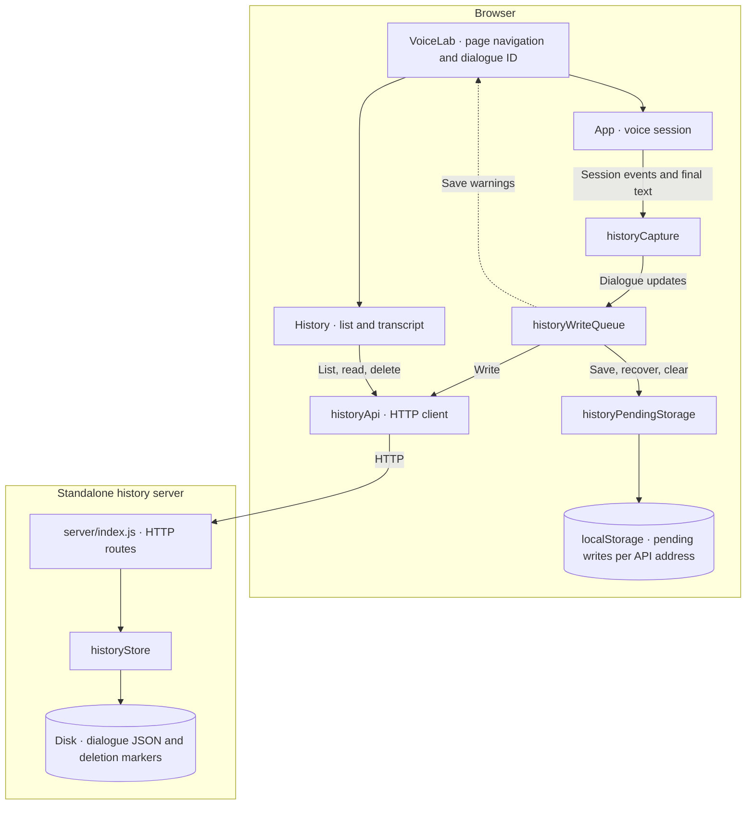
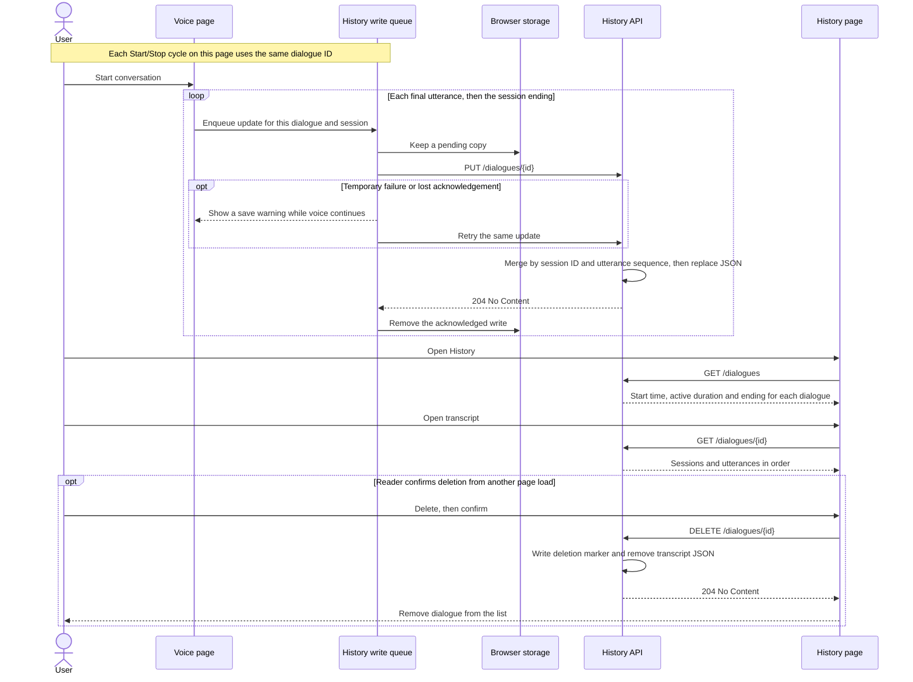

# Dialogue history

## Components

## Save, read and delete a dialogue

Each Start opens a voice session. All sessions started in one page load share a dialogue ID.
A silent first session stays in memory until a later session produces text. The first write
then includes both sessions, so the history summary counts their active time.

After a reload, the queue resumes pending writes for the configured API. If the browser
cannot store a pending copy, the queue keeps it in memory and asks the user to keep the
page open. A delayed write for a deleted dialogue receives HTTP 410, and the queue drops
the remaining writes for that dialogue.
